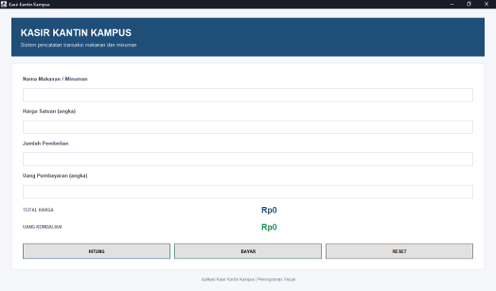
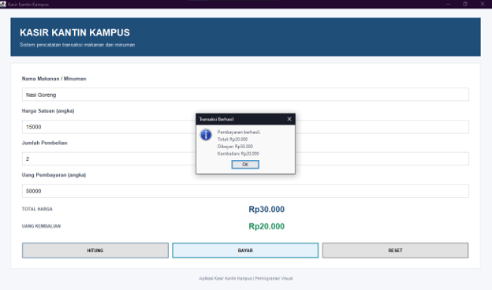
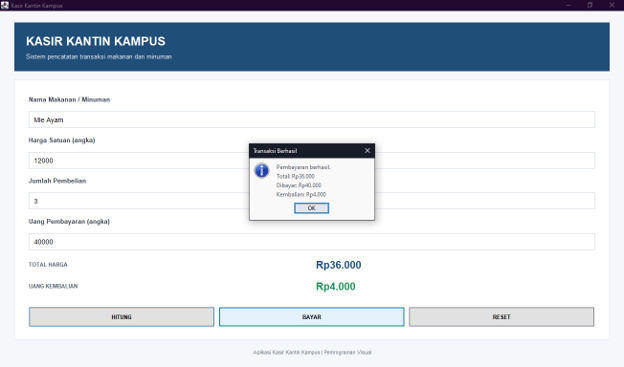
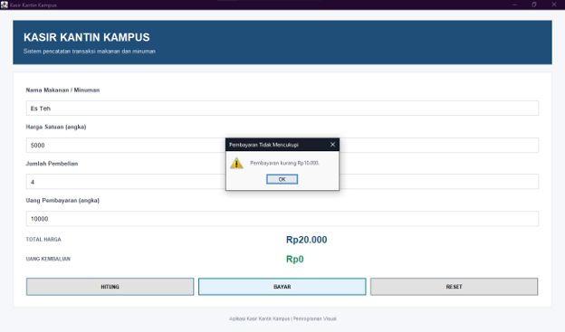

# APLIKASI KASIR KANTIN KAMPUS

## 1. Identitas Mahasiswa

- **Nama Lengkap:** Zahran Naufal Amar
- **NIM:** C2483207012
- **Kelas:** PTI5
- **Semester:** V
- **Mata Kuliah:** Pemrograman Visual
- **Dosen Pengampu:** Taofik Muhammad, M.Kom
- **Nama Aplikasi:** Kasir Kantin Kampus

## 2. Deskripsi Aplikasi

Kasir Kantin Kampus merupakan aplikasi desktop sederhana yang dibuat menggunakan bahasa pemrograman Java dengan library Java Swing melalui Apache NetBeans IDE.

Aplikasi ini dirancang untuk membantu proses transaksi penjualan makanan dan minuman di kantin kampus. Pengguna dapat memasukkan nama barang, harga satuan, jumlah pembelian, serta uang pembayaran. Sistem kemudian menghitung total harga dan menentukan uang kembalian secara otomatis.

Aplikasi ini dibuat tanpa menggunakan database karena seluruh proses transaksi dilakukan secara langsung dalam satu sesi penggunaan.

## 3. Tujuan Pembuatan

Tujuan pembuatan aplikasi ini adalah:
- Menerapkan pemrograman visual menggunakan Java Swing.
- Memahami penggunaan komponen antarmuka pada Java.
- Menerapkan perhitungan aritmatika dalam aplikasi desktop.
- Memahami konsep Event Handling menggunakan ActionListener.
- Menerapkan validasi input untuk menghindari kesalahan transaksi.

## 4. Fitur Aplikasi

Aplikasi Kasir Kantin Kampus memiliki beberapa fitur utama:

1. **Input Nama Barang**  
   Memasukkan nama makanan atau minuman yang dibeli.

2. **Input Harga Satuan**  
   Memasukkan harga satuan barang.

3. **Input Jumlah Pembelian**  
   Memasukkan jumlah barang yang dibeli.

4. **Perhitungan Total Harga**  
   Menghitung total harga berdasarkan harga satuan dikalikan jumlah pembelian.

5. **Proses Pembayaran**  
   Memasukkan jumlah uang yang dibayarkan oleh pembeli.

6. **Perhitungan Uang Kembalian**  
   Menghitung uang kembalian secara otomatis apabila pembayaran mencukupi.

7. **Validasi Input**  
   Memberikan peringatan apabila terdapat input kosong, karakter bukan angka, nilai negatif, jumlah pembelian tidak valid, atau pembayaran kurang.

8. **Tombol Reset**  
   Menghapus seluruh input dan hasil perhitungan serta mengembalikan fokus ke kolom nama barang.

## 5. Komponen Java Swing yang Digunakan

Berikut komponen yang digunakan dalam pembuatan aplikasi:

| Komponen | Fungsi |
|---|---|
| JFrame | Membuat jendela utama aplikasi |
| JPanel | Mengatur dan mengelompokkan komponen |
| JLabel | Menampilkan teks dan informasi |
| JTextField | Menerima input dari pengguna |
| JButton | Menjalankan perintah melalui tombol |
| JOptionPane | Menampilkan pesan informasi dan peringatan |

Selain itu, aplikasi menggunakan beberapa layout manager seperti BorderLayout, GridBagLayout, dan GridLayout untuk mengatur tata letak antarmuka.

## 6. Rumus Perhitungan

**Total Harga**

Total Harga = Harga Satuan × Jumlah Pembelian

**Uang Kembalian**

Uang Kembalian = Uang Pembayaran − Total Harga

Apabila uang pembayaran lebih kecil daripada total harga, aplikasi akan menampilkan pesan bahwa pembayaran masih kurang.

## 7. Pengujian Aplikasi

Pengujian dilakukan menggunakan data yang telah ditentukan dalam soal UTS.

| Nama Barang | Harga | Jumlah | Pembayaran | Hasil |
|---|---:|---:|---:|---|
| Nasi Goreng | Rp15.000 | 2 | Rp50.000 | Total Rp30.000, kembali Rp20.000 |
| Mie Ayam | Rp12.000 | 3 | Rp40.000 | Total Rp36.000, kembali Rp4.000 |
| Es Teh | Rp5.000 | 4 | Rp10.000 | Pembayaran kurang Rp10.000 |

Selain pengujian perhitungan, dilakukan juga pengujian validasi input untuk memastikan aplikasi dapat menangani kesalahan pemasukan data.

## 8. Struktur Folder Project

```text
UTS-Pemrograman-Visual-Kasir-Kantin/
│
├── src/
│   └── kasirkantinkampus/
│       └── KasirKantin.java
│
├── nbproject/
│   ├── project.xml
│   └── project.properties
│
├── screenshots/
│   ├── tampilan-utama.png
│   ├── hasil-total.png
│   └── hasil-pembayaran.png
│
├── build.xml
├── manifest.mf
└── README.md
```

## 9. Cara Menjalankan Aplikasi

1. Pastikan Java Development Kit (JDK) dan Apache NetBeans IDE sudah terinstal.
2. Download atau clone repository dari GitHub.
3. Ekstrak project apabila diunduh dalam bentuk ZIP.
4. Buka Apache NetBeans IDE.
5. Pilih menu **File → Open Project**.
6. Pilih folder `UTS-Pemrograman-Visual-Kasir-Kantin`.
7. Klik kanan project, kemudian pilih **Clean and Build**.
8. Jalankan aplikasi dengan menekan tombol **F6** atau memilih **Run Project**.

## 10. Dokumentasi Screenshot

### A. Tampilan Utama Aplikasi



### B. Hasil Perhitungan dan Pembayaran Nasi Goreng



### C. Hasil Perhitungan dan Pembayaran Mie Ayam



### D. Hasil Perhitungan dan Pembayaran Es Teh



## 11. Teknologi yang Digunakan

- Bahasa Pemrograman: Java
- GUI Library: Java Swing
- IDE: Apache NetBeans
- Layout Manager: BorderLayout, GridBagLayout, GridLayout
- Version Control: Git dan GitHub

## 12. Penutup

Demikian dokumentasi aplikasi Kasir Kantin Kampus yang dibuat sebagai pemenuhan tugas Ujian Tengah Semester mata kuliah Pemrograman Visual.

Melalui proyek ini, diharapkan dapat memahami penerapan Java Swing, penggunaan komponen antarmuka, perhitungan transaksi, event handling, serta validasi input dalam pembuatan aplikasi desktop sederhana.

---

**Universitas Muhammadiyah Tasikmalaya**  
**Program Studi Pendidikan Teknologi Informasi**  
**Tahun Akademik 2026/2027 Ganjil**
